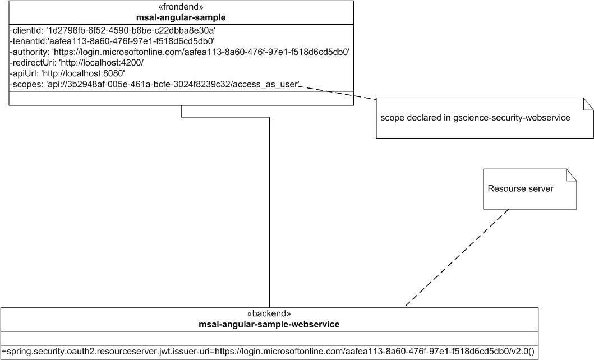
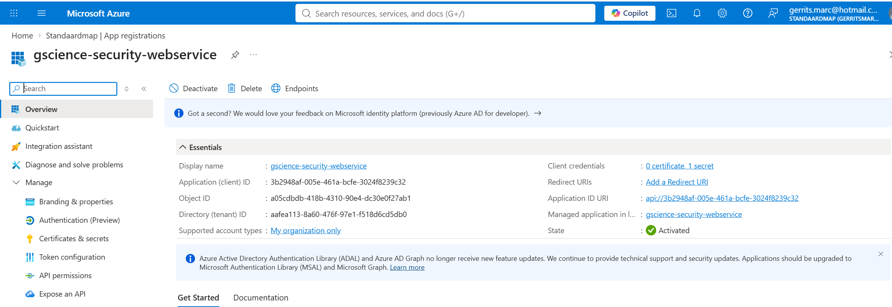
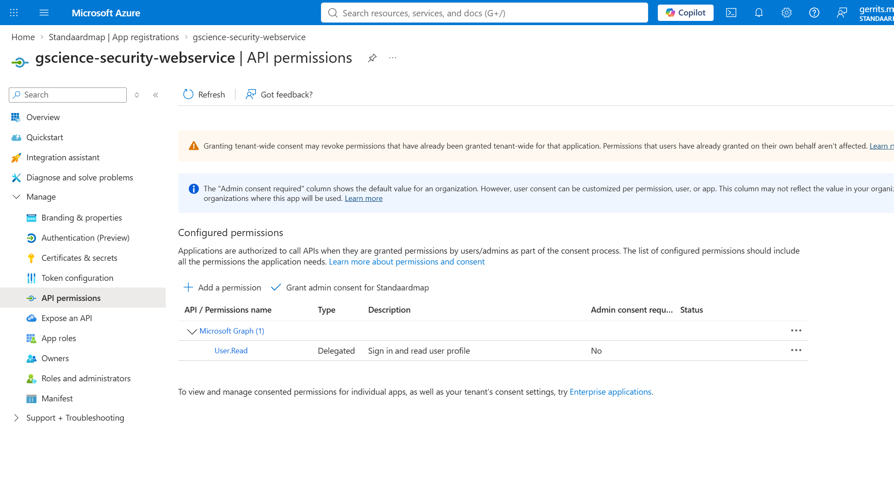
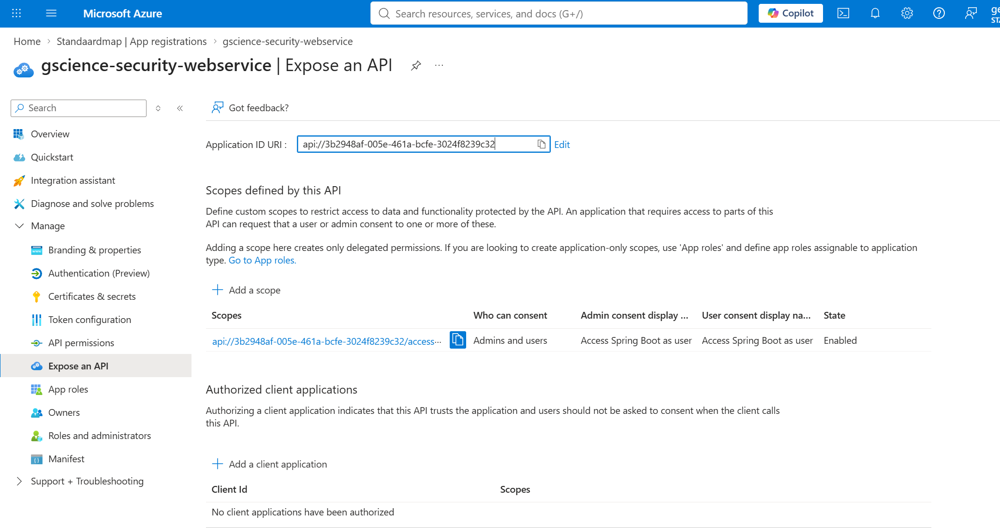
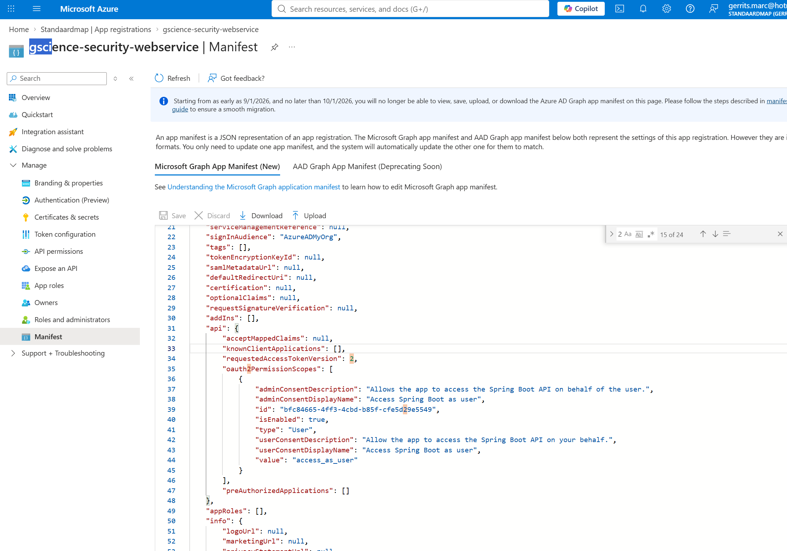

# Project for testing Microsoft Entra ID

## Overview of Architecture


## Imp[overview.pdf](images/overview.pdf)lementation of Microsoft Entra ID

### Azure formats




add this "requestedAccessTokenVersion": 2,


### The security filter
```java
package com.msal.angular.msal_angular_sample.webservice.security;

import org.springframework.context.annotation.Bean;
import org.springframework.context.annotation.Configuration;
import org.springframework.security.config.Customizer;
import org.springframework.security.config.annotation.web.builders.HttpSecurity;
import org.springframework.security.config.annotation.web.configurers.AbstractHttpConfigurer;
import org.springframework.security.web.SecurityFilterChain;

@SuppressWarnings("java:S4502")
@Configuration
public class SecurityConfig {

    @Bean
    public SecurityFilterChain securityFilterChain(HttpSecurity http){
        http
                .cors(Customizer.withDefaults())
                .csrf(AbstractHttpConfigurer::disable)
                .authorizeHttpRequests(auth -> auth
                        // Allow public access to Swagger UI and OpenAPI documentation
                        .requestMatchers(
                                "/swagger-ui/**",
                                "/v3/api-docs/**",
                                "/swagger-ui.html"
                        ).permitAll()
                        // All other endpoints (like /api/protected) require authentication
                        .anyRequest().authenticated()
                )
                .oauth2ResourceServer(oauth2 -> oauth2.jwt(Customizer.withDefaults()));

        return http.build();
    }
}

```

``` resource file
spring.security.oauth2.resourceserver.jwt.issuer-uri=https://login.microsoftonline.com/aafea113-8a60-476f-97e1-f518d6cd5db0/v2.0
springdoc.swagger-ui.oauth.use-pkce-with-authorization-code-grant=true
springdoc.swagger-ui.oauth.client-id=3b2948af-005e-461a-bcfe-3024f8239c32
```

## Controller endpoint security implementation

### The annotation implementation
```java
package com.msal.angular.msal_angular_sample.webservice.annotation;

import org.springframework.security.access.prepost.PreAuthorize;

import java.lang.annotation.ElementType;
import java.lang.annotation.Retention;
import java.lang.annotation.RetentionPolicy;
import java.lang.annotation.Target;

@Target({ElementType.METHOD, ElementType.TYPE})
@Retention(RetentionPolicy.RUNTIME)
// Calls the 'dbSecurity' bean we defined above and passes the current authentication
@PreAuthorize("@dbSecurity.isAdmin(authentication)")
public @interface AdminOnly {
}
```

### The security component add to the annotation implementation
```java
package com.msal.angular.msal_angular_sample.webservice.annotation;

import org.springframework.security.core.Authentication;
import org.springframework.security.oauth2.jwt.Jwt;
import org.springframework.stereotype.Component;

@Component("dbSecurity")
public class DatabaseSecurityEvaluator {

    // Inject your database repository here when ready
    // private final UserRepository userRepository;

    public boolean isAdmin(Authentication authentication) {

        if (authentication != null && authentication.getPrincipal() instanceof Jwt jwt) {

            // Extract the 'oid' directly from the claims map seen in your debugger
            String oid = jwt.getClaimAsString("oid");
            String email = jwt.getClaimAsString("preferred_username");
            String name = jwt.getClaimAsString("name");

            // Build a log message using StringBuilder
            StringBuilder stringBuilder = new StringBuilder();
            stringBuilder.append("Evaluating Admin Access -> ")
                    .append("OID: ").append(oid)
                    .append(", Email: ").append(email)
                    .append(", Name: ").append(name);

            // Print out the details for debugging
            System.out.println(stringBuilder.toString());

            // Query database to check if this user's OID has admin privileges
            // return userRepository.existsByOidAndRole(oid, "ADMIN");
        }

        return true; // placeholder logic
    }
}
```

### Enable the methode security
```java
package com.msal.angular.msal_angular_sample.webservice.annotation;

import org.springframework.context.annotation.Configuration;
import org.springframework.security.config.annotation.method.configuration.EnableMethodSecurity;

@Configuration
@EnableMethodSecurity(
        securedEnabled = true,
        jsr250Enabled = true
)
public class MethodSecurityConfig {
}

```

## swagger url
http://localhost:8080/swagger-ui/index.html